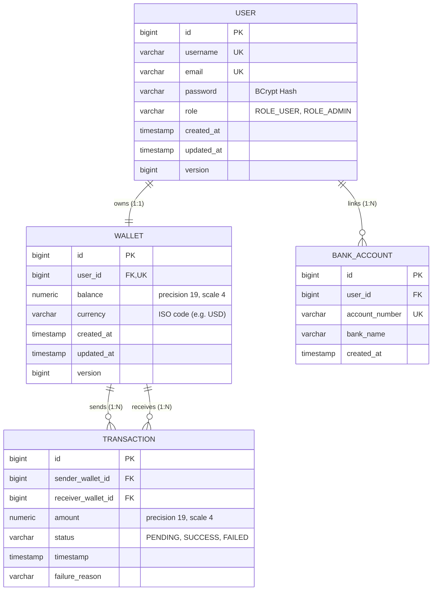

<div align="center">


[Repository](https://github.com/Chakaliprakash/Secure-Digital-Wallet--Banking-API) · [Issues](https://github.com/Chakaliprakash/Secure-Digital-Wallet--Banking-API/issues)

</div>

---

[](https://www.oracle.com/java/)
[](https://spring.io/projects/spring-boot)
[](https://react.dev/)
[](https://tailwindcss.com/)
[](https://www.postgresql.org/)
[](https://www.docker.com/)
[](http://localhost:8080/swagger-ui.html)
[](LICENSE)

A production-grade, enterprise backend banking API and modern **React Fintech Dashboard** designed for high-concurrency digital wallet operations. Built strictly adhering to **SOLID principles**, **Clean Layered Architecture**, **Domain-Driven Design (DDD)**, and **stateless security standards**.

---

## 🏛️ System Architecture

```mermaid
graph TD
    Client[HTTP Client / Mobile App / Swagger UI] -->|Authorization: Bearer JWT| Gateway[Spring Security 6 Filter Chain]
    Gateway --> JwtFilter[JwtAuthenticationFilter]
    JwtFilter -->|Populate Authentication| SecCtx[SecurityContextHolder]
    JwtFilter --> Controller[REST API Controllers]

    subgraph API Layer
        Controller --> AuthCtrl[AuthController]
        Controller --> WalletCtrl[WalletController]
        Controller --> TxCtrl[TransactionController]
        Controller --> BankCtrl[BankAccountController]
    end

    subgraph Service & Domain Layer
        AuthCtrl --> AuthService[AuthService]
        WalletCtrl --> WalletService[WalletService]
        TxCtrl --> TxService[TransactionService]
        BankCtrl --> BankService[BankAccountService]
    end

    subgraph Concurrency & Transaction Management
        TxService -->|@Transactional READ_COMMITTED| TxBoundary[ACID Boundary]
        TxBoundary -->|Ordered PESSIMISTIC_WRITE Lock| DB[(PostgreSQL Database)]
    end

    Controller -.->|Standardized RFC-7807 Errors| GlobalAdvisor[GlobalExceptionHandler]
```

---

## 🗄️ Entity Relationship (ER) Model



---

## ⚡ Core Enterprise Highlights

### 1. Deadlock-Free Canonical Locking
In high-throughput peer-to-peer transfers, concurrent transfers in opposite directions (User A $\rightarrow$ User B and User B $\rightarrow$ User A) will trigger a circular wait deadlock if locks are acquired arbitrarily.
To prevent this, the engine enforces **Canonical Lock Ordering**:
```java
// Always acquire locks in ascending order of wallet ID:
Long firstLockId = Math.min(senderId, receiverId);
Long secondLockId = Math.max(senderId, receiverId);

Wallet firstLocked  = walletRepository.findByIdForUpdate(firstLockId);
Wallet secondLocked = walletRepository.findByIdForUpdate(secondLockId);
```
Both threads acquire locks in the exact same order (`min` $\rightarrow$ `max`), mathematically eliminating circular wait conditions.

### 2. ACID Transaction Rollback Verification
All balance modifications are executed inside `@Transactional(isolation = Isolation.READ_COMMITTED, rollbackFor = Exception.class)`. Setting `"simulateFailure": true` in the transfer payload debits the sender and deliberately triggers a `TransferSimulationException`. Spring's transaction interceptor catches this and rolls back the database operation immediately—leaving the sender's balance completely untouched.

### 3. Strict Stateless JWT Security
- HMAC-SHA256 token signing with 256-bit cryptographically secure keys.
- Custom `JwtAuthenticationFilter` and `JwtAuthenticationEntryPoint` returning RFC-7807 compliant 401 Unauthorized JSON payloads.
- Passwords hashed with `BCryptPasswordEncoder`.

### 4. DTO Isolation & Standardized Error Handling
- Domain entities are never exposed in REST controllers.
- Java 21 Records with Jakarta validation (`@NotBlank`, `@DecimalMin`, `@Email`).
- `GlobalExceptionHandler` intercepting all exceptions with structured error contracts:
```json
{
  "timestamp": "2026-09-09T15:10:00.000Z",
  "status": 400,
  "error": "Bad Request",
  "message": "Insufficient funds in wallet 1. Available: 50.00, Required: 100.00",
  "path": "/api/v1/transactions/transfer"
}
```

---

## 🚀 Quickstart Guide

### Method A: One-Command Docker Setup (Recommended)
Make sure Docker is running on your machine:
```bash
docker compose up -d --build
```
This automatically boots:
- **PostgreSQL 16**: Port `5432`
- **Wallet Banking API**: Port `8080`
- **pgAdmin 4**: Port `5050` (`admin@wallet.internal` / `admin`)

### Method B: Local Maven Execution
1. Ensure PostgreSQL is running on `localhost:5432` with a database named `wallet_db`.
2. Run the application:
```bash
mvn spring-boot:run
```

---

## 📖 Interactive Documentation (Swagger UI)

Access interactive OpenAPI 3 documentation in your browser:
**`http://localhost:8080/swagger-ui.html`**

Click the **Authorize** button and paste your Bearer token:
```
Bearer <your_jwt_access_token>
```

---

## 🛠️ API Reference & cURL Examples

### 1. Register User 1 (Alice) with $500 Initial Deposit
```bash
curl -X POST http://localhost:8080/api/v1/auth/register \
  -H "Content-Type: application/json" \
  -d '{
    "username": "alice_smith",
    "email": "alice@example.com",
    "password": "Password123!",
    "initialDeposit": 500.00
  }'
```
*Response: Returns user details, JWT access token, and auto-provisioned Wallet ID (e.g. `1`).*

### 2. Register User 2 (Bob) with $100 Initial Deposit
```bash
curl -X POST http://localhost:8080/api/v1/auth/register \
  -H "Content-Type: application/json" \
  -d '{
    "username": "bob_jones",
    "email": "bob@example.com",
    "password": "Password123!",
    "initialDeposit": 100.00
  }'
```
*Response: Returns user details, JWT access token, and auto-provisioned Wallet ID (e.g. `2`).*

### 3. Check Wallet Balance
```bash
curl -X GET http://localhost:8080/api/v1/wallets/1/balance \
  -H "Authorization: Bearer <ALICE_JWT_TOKEN>"
```

### 4. Execute P2P Money Transfer (Alice sends $150 to Bob)
```bash
curl -X POST http://localhost:8080/api/v1/transactions/transfer \
  -H "Content-Type: application/json" \
  -H "Authorization: Bearer <ALICE_JWT_TOKEN>" \
  -d '{
    "senderWalletId": 1,
    "receiverWalletId": 2,
    "amount": 150.00,
    "description": "Project milestone reimbursement",
    "simulateFailure": false
  }'
```

### 5. Demonstrate ACID Rollback (Simulate Failure Scenario)
```bash
curl -X POST http://localhost:8080/api/v1/transactions/transfer \
  -H "Content-Type: application/json" \
  -H "Authorization: Bearer <ALICE_JWT_TOKEN>" \
  -d '{
    "senderWalletId": 1,
    "receiverWalletId": 2,
    "amount": 50.00,
    "description": "Testing transaction rollback",
    "simulateFailure": true
  }'
```
*Result: HTTP 500 returned with message `"Simulated post-debit catastrophe! Spring @Transactional MUST roll back the debit"`. Re-check Alice's balance—it remains completely untouched!*

### 6. View Paginated Transaction History
```bash
curl -X GET "http://localhost:8080/api/v1/transactions/wallet/1?page=0&size=10" \
  -H "Authorization: Bearer <ALICE_JWT_TOKEN>"
```

### 7. Link an External Bank Account
```bash
curl -X POST http://localhost:8080/api/v1/bank-accounts/user/1 \
  -H "Content-Type: application/json" \
  -H "Authorization: Bearer <ALICE_JWT_TOKEN>" \
  -d '{
    "accountNumber": "123456789012",
    "bankName": "JPMorgan Chase"
  }'
```

---

## 🧪 Automated Testing

Execute the unit test suite verifying thread-safe transfers, deadlock prevention, balance limits, and simulated rollback:
```bash
mvn test
```

---

## 📄 License
This project is licensed under the Apache 2.0 License - see the [LICENSE](LICENSE) file for details.

